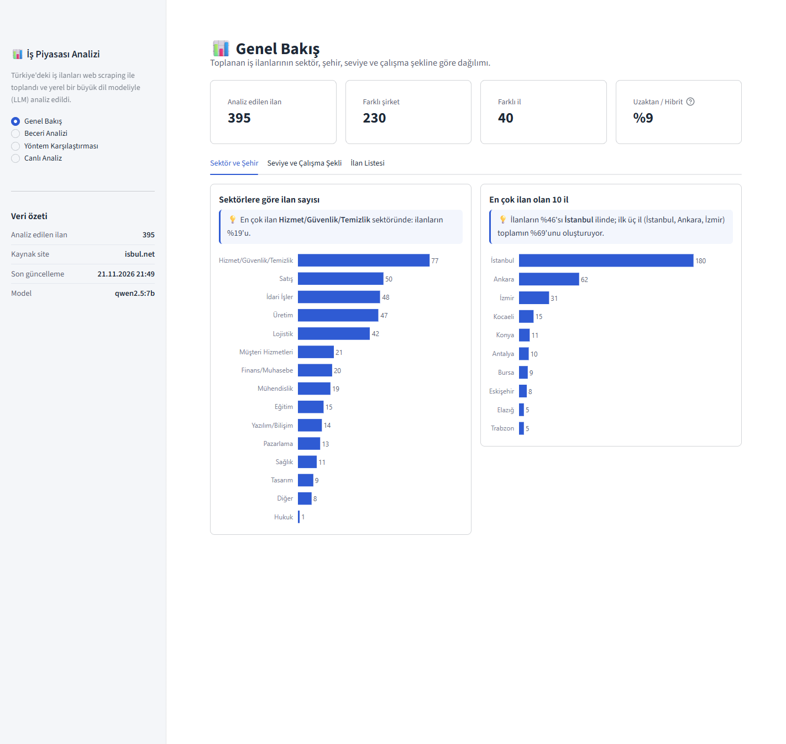
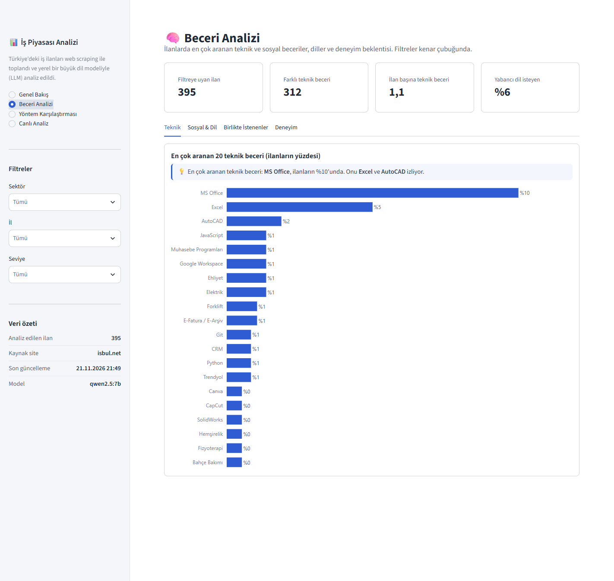
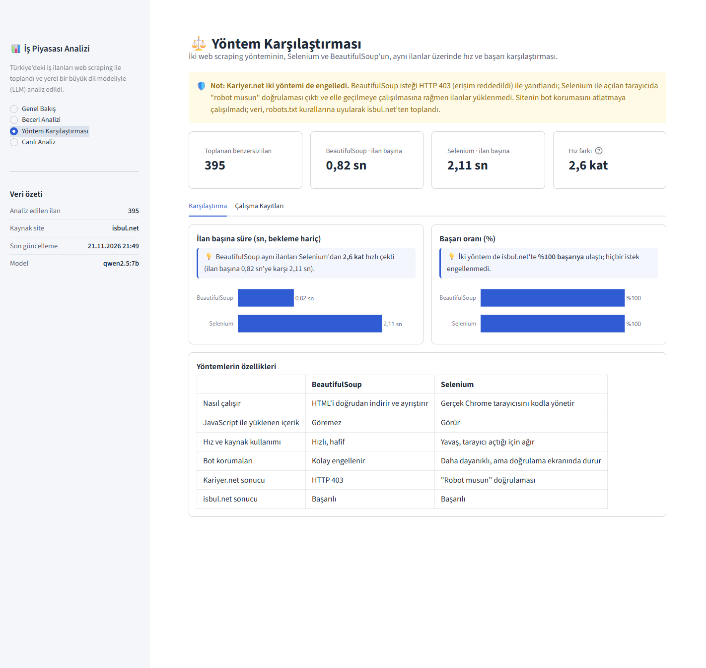
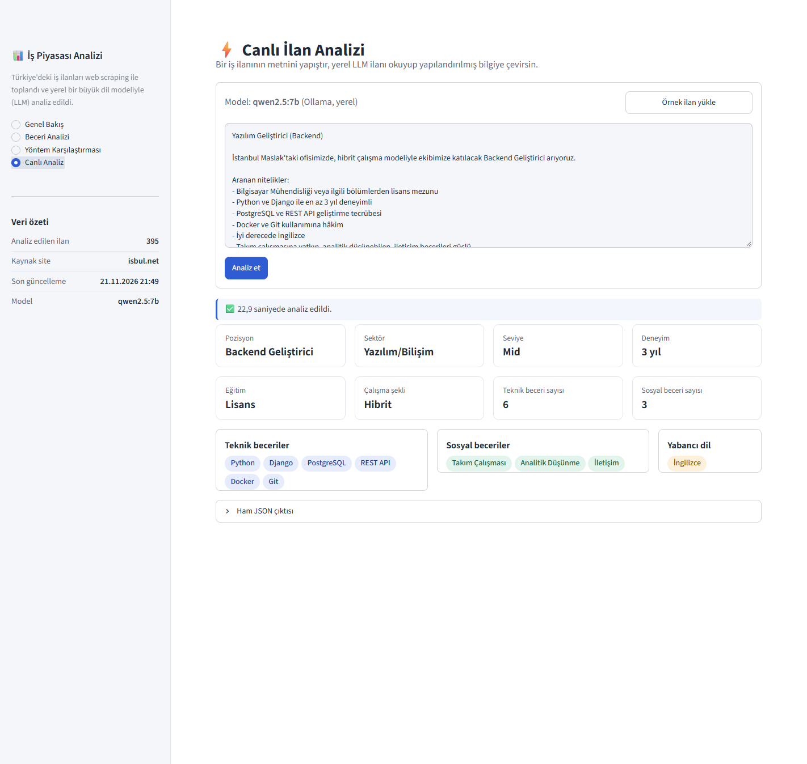

# LLM Destekli Türkiye İş Piyasası Analizi

> ⚠️ **Yalnızca akademik amaçlıdır.** Bu depo bir Yapay Zekâ dersi proje ödevidir. Toplanan veri
> ticari amaçla kullanılmaz, yeniden dağıtılmaz; ilan metinleri depoya konmamıştır.
> Kod MIT lisanslıdır; veri yalnızca akademik amaçlıdır (bkz. [Lisans](#lisans)).

Türkiye'deki iş ilanlarını iki farklı web scraping yöntemiyle (**Selenium** ve **BeautifulSoup**)
toplayıp yerel bir büyük dil modeliyle (**Ollama, Qwen 2.5 7B**) yapılandırılmış veriye dönüştüren
ve sonuçları **Streamlit** arayüzünde gösteren proje.

```
Scraper'lar ──> data/raw/ilanlar.csv ──> LLM (Ollama) ──> data/processed/*.jsonl ──> Streamlit arayüzü
                                                                 └──> data/public/ (paylaşılan hafif kopya)
```

LLM her ilandan şunları çıkarır: pozisyon, sektör, seviye, deneyim yılı, teknik beceriler,
sosyal beceriler, eğitim düzeyi, çalışma şekli ve yabancı diller. Çıktı, Ollama'nın
*structured outputs* özelliğiyle bir JSON şemasına (Pydantic) uymaya zorlanır.

**Canlı demo:** https://is-piyasasi-llm.streamlit.app/ (Streamlit Community Cloud; Canlı Analiz
sayfası Ollama gerektirdiği için yalnızca yerel kurulumda çalışır)

## Veri kaynağı ve Kariyer.net bulgusu

Proje başlangıçta Kariyer.net için tasarlandı, ancak site **iki yöntemi de engelledi**:

| Yöntem | Kariyer.net sonucu |
|---|---|
| BeautifulSoup (requests) | HTTP **403** (erişim reddedildi) |
| Selenium (gerçek Chrome) | "Robot musun?" doğrulaması; elle geçilmeye çalışılsa da ilanlar yüklenmedi |

Sitenin bot korumasını **atlatmaya çalışılmadı**. Bunun yerine bot doğrulaması koymayan ve
`robots.txt` dosyası liste/ilan sayfalarının taranmasına izin veren **[isbul.net](https://www.isbul.net)**
kullanıldı. İlan sayfalarındaki schema.org `JobPosting` (JSON-LD) verisinden başlık, şirket,
il/ilçe ve ilan metni okunur. Tüm ilanların telif ve içerik hakları ilgili site ve işverenlere aittir.

**Sonuç:** isbul.net'ten 40 farklı ilden **395 benzersiz ilan** toplandı. Asıl toplama turlarında
(10 ilanlık denemeler hariç) BeautifulSoup ilan başına **0,82 sn** (100/100), Selenium **2,11 sn**
(395/395) sürdü (bekleme hariç, ~2,6 kat fark); iki yöntem de %100 başarılı oldu.

## Ekran görüntüleri

| Genel Bakış | Beceri Analizi |
|---|---|
|  |  |
| **Yöntem Karşılaştırması** | **Canlı Analiz** (yerel kurulum) |
|  |  |

## Klasör yapısı
```
is-ilani-analizi/
├── baslat.bat              # Windows: Ollama + model ısıtma + arayüzü tek tıkla açar
├── config.py               # tüm ayarlar (site adresleri, model, bekleme süresi)
├── scrapers/
│   ├── common.py           # ortak fonksiyonlar (JSON-LD ayrıştırma, robots.txt, CSV)
│   ├── bs4_scraper.py      # Yöntem 1: requests + BeautifulSoup
│   ├── selenium_scraper.py # Yöntem 2: Selenium (gerçek Chrome)
│   ├── istatistik.py       # yöntemlerin hız/başarı ölçümü
│   └── birlestir.py        # iki yöntemin verisini birleştirir
├── llm/
│   ├── sema.py             # JSON şeması + prompt + analiz fonksiyonu
│   ├── normalize.py        # "JS"/"Javascript" -> "JavaScript" gibi beceri adı birleştirme
│   ├── dogrula.py          # eğitim düzeyinin ilan metnine göre kurala dayalı doğrulanması
│   ├── cikar.py            # tüm ilanları LLM'den geçirir
│   ├── disa_aktar.py       # arayüz için ilan metni içermeyen hafif veri (data/public)
│   ├── etiketle.py         # (sade sürümde kullanılmadı) elle etiketleme şablonu
│   └── degerlendir.py      # (sade sürümde kullanılmadı) model karşılaştırması
├── app/app.py              # Streamlit arayüzü (4 sayfa)
├── .streamlit/config.toml  # arayüz teması
└── data/
    ├── raw/                # ham ilanlar (repoda yok)
    ├── processed/          # LLM çıktıları (repoda yok)
    └── public/             # repoda paylaşılan hafif veri
```

## 1) Kurulum
1. **Python 3.10+** ve **Google Chrome** kurulu olmalı.
2. Depoyu indir ve sanal ortam kur:
   ```
   git clone https://github.com/mehmetKrca/is-ilani-analizi.git
   cd is-ilani-analizi
   python -m venv .venv
   .venv\Scripts\activate          (Windows)   |   source .venv/bin/activate   (macOS/Linux)
   pip install -r requirements-local.txt
   ```
   `requirements.txt` yalnızca arayüzün paketlerini içerir (Streamlit Cloud bunu kullanır);
   `requirements-local.txt` buna scraping ve LLM paketlerini ekler.
3. **Ollama**: https://ollama.com adresinden indirip kur, sonra modeli indir:
   ```
   ollama pull qwen2.5:7b
   ollama run qwen2.5:7b "Merhaba"
   ```
   > Eski bir NVIDIA sürücüsünde `CUDA error: device kernel image is invalid` hatası alınırsa
   > Ollama'yı CUDA kapalı başlatmak yeterli (GPU yine Vulkan üzerinden kullanılır):
   > `set CUDA_VISIBLE_DEVICES=-1` ardından `ollama serve` (yalnızca o terminal için geçerlidir).

Sadece arayüzü hazır veriyle görmek istersen 3. adım gerekmez: `streamlit run app/app.py`
komutu `data/public/` altındaki veriyle çalışır (Canlı Analiz sayfası hariç).

## 2) Veri toplama
```
python -m scrapers.selenium_scraper --sayfa 2 --limit 10 --goster        # küçük deneme, tarayıcıyı görerek
python -m scrapers.selenium_scraper --sayfa 10 --limit 400               # asıl toplama (linkler.txt de oluşur)
python -m scrapers.bs4_scraper --urls data/raw/linkler.txt --limit 100   # aynı linkler, diğer yöntem
python -m scrapers.birlestir
```
- Varsayılan site `isbul`'dur (`--site` ile değiştirilebilir; ayarlar `config.py`'de).
- Her iki yöntem de `robots.txt`'e uyar (joker karakterli kurallar dahil) ve istekler arasında 2,5 sn bekler.
- Yarıda kesilirse tekrar çalıştır, daha önce çekilen ilanları atlar.
- Selenium liste sayfasında ilanları 20 sn bekler; çıkmazsa `--goster` modunda kullanıcıdan
  doğrulamayı elle geçmesini ister, yine olmazsa sayfanın ekran görüntüsünü ve HTML'ini `data/raw`'a kaydeder.
- Ölçümler `data/raw/scraping_istatistik.csv`'ye yazılır.

## 3) LLM ile bilgi çıkarma
```
python -m llm.cikar --limit 5      # önce deneme
python -m llm.cikar                # tüm ilanlar (RTX 4050 / Vulkan'da ilan başına ~10-12 sn)
python -m llm.disa_aktar           # arayüzün paylaşılan kopyasını (data/public) günceller
```

## 4) Web arayüzü
```
streamlit run app/app.py
```
**Windows'ta tek tıkla:** proje klasöründeki `baslat.bat`'a çift tıkla. Betik Ollama tepsi
uygulamasını kapatır, `ollama serve`'ü CUDA kapalı (Vulkan GPU) başlatır, `qwen2.5:7b`'yi bir kez
ısıtır, Streamlit'i açar ve tarayıcıda http://localhost:8501'i gösterir. Ayarlar yalnızca o
pencereler için geçerlidir. Kapatmak için pencerede **Ctrl+C**'ye bas, "Toplu iş sonlandırılsın mı?"
sorusuna **H** de (Ollama da kapanır) ya da iki pencereyi X ile kapat.

| Sayfa | İçerik |
|---|---|
| **Genel Bakış** | sektör, il, seviye ve çalışma şekli dağılımları, aranabilir ilan listesi |
| **Beceri Analizi** | kenar çubuğunda sektör/il/seviye filtreleri; teknik, sosyal ve dil becerileri, birlikte istenen beceriler ısı haritası, deneyim dağılımı |
| **Yöntem Karşılaştırması** | Selenium ve BeautifulSoup'un hız ve başarı karşılaştırması, Kariyer.net notu |
| **Canlı Analiz** | ilan metnini yapıştır, yerel LLM anında analiz etsin (yalnızca Ollama çalışan yerel kurulumda) |

Arayüz yerelde tam veriyi (`data/raw` + `data/processed`), bunlar yoksa `data/public`'i kullanır.

### Uyanık tutma (GitHub Actions)
Streamlit Community Cloud, uzun süre ziyaret edilmeyen uygulamayı uykuya alır. `.github/workflows/keep-alive.yml`
her 6 saatte bir (ve Actions sekmesinden elle) `scripts/keep_alive.py`'yi çalıştırır: betik uygulamayı
Playwright ile headless Chromium'da açar, uyku ekranı çıkarsa "Yes, get this app back up!" butonuna basar
ve uygulamanın yüklendiğini (iframe dahil) en fazla ~3 dakika bekleyerek doğrular. Token/secret gerekmez.
Yerelde denemek için: `pip install playwright && python -m playwright install chromium && python scripts/keep_alive.py`

## Bilinen sınırlılıklar
- 7B'lik bir yerel model kullanıldığı için çıkarımlar hatasız değildir; özellikle eğitim düzeyi ve
  teknik beceriler için prompt'a "sadece ilanda açıkça geçeni yaz" kuralları eklendi.
- Eğitim düzeyi ayrıca kurala dayalı olarak doğrulanır (`llm/dogrula.py`): ilk prompt 395 ilanda
  55 Doktora/Yüksek Lisans etiketi uydurdu (54'ünün metinde dayanağı yoktu); düzeltilmiş prompt
  bunu sıfıra indirdi ama "lisans"ı "lise" ile karıştırdı. Etiket metinde geçmiyorsa metindeki en
  düşük düzeye, hiç düzey yoksa "Belirtilmemiş"e çevrilir. Düzeltilen kayıtlarda modelin ilk cevabı
  `data/public` içindeki `duzeltme` alanında saklanır.
- Veri tek bir siteden ve belirli bir tarihte toplanmıştır; Türkiye iş piyasasının tamamını temsil etmez.

## Etik notlar
Yalnızca herkese açık ilan içerikleri toplanır, kişisel veri toplanmaz; `robots.txt` kurallarına
uyulur, bot korumaları atlatılmaz ve siteye yük bindirmemek için istekler yavaşlatılır.
Ham ilan metinleri depoda paylaşılmaz. Veri **yalnızca akademik amaçla** kullanılır.

## Lisans
**Kod MIT lisanslıdır; veri yalnızca akademik amaçlıdır.** Kodun lisans metni için
[LICENSE](LICENSE) dosyasına bakın. MIT lisansı yalnızca bu depodaki kodu kapsar;
`data/public/` altındaki ilan künyeleri ve bunlardan türetilen analiz sonuçları üzerindeki
haklar ilgili site ve işverenlere aittir ve bu veri ticari amaçla kullanılamaz.
